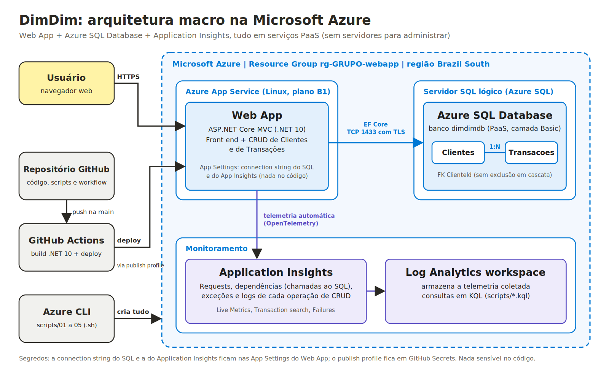
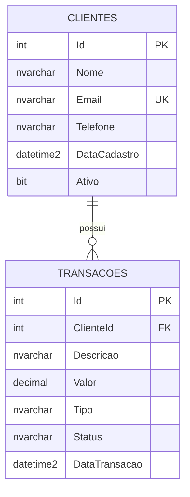

f# DimDim Web App - 2º Checkpoint de DevOps Tools & Cloud Computing

Aplicação web em **ASP.NET Core MVC (.NET 10)** para a consultoria do nosso grupo apresentar ao CEO da DimDim (Steve Jobs): cadastro de clientes e registro de transações, com **front end**, dados no **Azure SQL Database**, deploy automatizado e monitoramento com **Application Insights**. Tudo roda na nuvem da Microsoft, em serviços PaaS.

## Grupo

| Item | Informação |
|---|---|
| Nome do grupo | C_A_V Enterprise |
| Integrantes (RM e nome) | RM564227 Vitor Augusto|
| Vídeo com as evidências | [PREENCHER: link do vídeo] |

> Este projeto **não** é a aplicação da Sprint 3 e **não** roda em localhost: a entrega está publicada no Azure App Service.

---

## 1. Descrição da solução

O **dimdim** é um mini-sistema de pagamentos com duas entidades relacionadas:

- **Clientes**: quem usa o dimdim (nome, e-mail único, telefone, situação ativo/inativo).
- **Transações**: pagamentos, recebimentos e transferências de um cliente (descrição, valor, tipo, status e data).

Cada cliente pode ter várias transações (relacionamento 1:N). As duas tabelas têm **CRUD completo** com telas próprias (listar, detalhar, criar, editar e excluir). Regras de negócio implementadas:

- e-mail de cliente não pode se repetir;
- valor da transação precisa ser maior que zero;
- cliente inativo não recebe novas transações;
- cliente que possui transações **não pode ser excluído** (integridade do relacionamento, garantida na aplicação e por chave estrangeira no banco).

A aplicação registra em log cada operação de CRUD e os comandos SQL executados. Esses dados, junto com requisições, chamadas ao banco (dependências) e exceções, são enviados ao **Application Insights**.

> **JSON das operações (GET, POST, PUT, DELETE):** não se aplica. A entrega é uma aplicação MVC com front end, não uma API.

## 2. Arquitetura



Arquivo editável: [`docs/arquitetura.svg`](docs/arquitetura.svg).

| Recurso Azure | Função | Criado por |
|---|---|---|
| Resource Group `rg-<grupo>-webapp` | Agrupa todos os recursos | `01-criar-recursos.sh` |
| App Service Plan (Linux, B1) + Web App | Hospeda a aplicação .NET 10 | `01-criar-recursos.sh` |
| Servidor SQL + Azure SQL Database `dimdimdb` | Persistência dos dados (PaaS, não containerizado) | `01-criar-recursos.sh` |
| Application Insights + Log Analytics | Monitoramento da aplicação e das chamadas ao banco | `01-criar-recursos.sh` |
| App Settings do Web App | Guardam a connection string do SQL e a do App Insights | `01-criar-recursos.sh` |
| GitHub Actions | Build e deploy automatizados | `.github/workflows/deploy.yml` |

## 3. Modelo de dados

DDL completo em [`scripts/ddl-tabelas.sql`](scripts/ddl-tabelas.sql).



## 4. Estrutura do repositório

```
.
├── .github/workflows/deploy.yml     # Pipeline: build .NET + deploy no Web App
├── docs/                            # Desenho da arquitetura (SVG e PNG)
├── scripts/                         # DDL das tabelas e scripts do Azure CLI
│   ├── ddl-tabelas.sql              #   DDL (Clientes e Transacoes)
│   ├── 01-criar-recursos.sh         #   Cria toda a infraestrutura na Azure
│   ├── 02-criar-tabelas.sh          #   Executa o DDL no Azure SQL
│   ├── 03-configurar-github-actions.sh  # Configura secret/variável do deploy
│   ├── 04-deploy-manual.sh          #   Alternativa: az webapp deploy
│   ├── 05-remover-recursos.sh       #   Apaga tudo ao final
│   ├── consultas-evidencias.sql     #   SELECTs para mostrar os dados no vídeo
│   └── consultas-appinsights.kql    #   Consultas KQL do Application Insights
└── src/DimDim.Web/                  # Código-fonte da aplicação (MVC + EF Core)
    ├── Controllers/  Models/  Data/  Views/  wwwroot/
    └── Program.cs
```

---

## 5. How-to: implantação completa na nuvem

### Pré-requisitos

- Assinatura do Azure ativa (ex.: Azure for Students) e conta no GitHub.
- **Azure Cloud Shell (Bash)** em <https://shell.azure.com>, que já traz `az`, `sqlcmd`, `git` e `zip`, sem instalar nada. Também funciona em terminal local com [Azure CLI](https://learn.microsoft.com/cli/azure/install-azure-cli) e `az login`.
- Os scripts são bash. No Windows, use o Cloud Shell, o WSL ou o Git Bash.

### Passo 1: colocar o código no GitHub

Crie um repositório vazio no GitHub e envie este projeto (na sua máquina):

```bash
git init -b main
git add .
git commit -m "DimDim: versão inicial"
git remote add origin https://github.com/<usuario>/<repositorio>.git
git push -u origin main
```

> No primeiro push o workflow executa só o **build**; o deploy é ignorado até o Passo 4.
> Adicione o professor como colaborador (ou deixe o repositório público) para que ele consiga acessar.

Abra o Cloud Shell e baixe o repositório:

```bash
git clone https://github.com/<usuario>/<repositorio>.git
cd <repositorio>
```

### Passo 2: criar os recursos na Azure (Azure CLI)

```bash
GRUPO=<nome_do_grupo> bash scripts/01-criar-recursos.sh
```

`<nome_do_grupo>` deve ter de 3 a 12 caracteres (minúsculas e números). O script pede a **senha do administrador do SQL** sem exibi-la na tela (mín. 12 caracteres, use letras, números e `_ - # @ %`). **Guarde essa senha**, ela será pedida no Passo 3. Em cerca de 10 minutos ele cria, nesta ordem:

1. Resource Group;
2. Log Analytics workspace e **Application Insights**;
3. Servidor **Azure SQL** e regras de firewall (libera serviços do Azure);
4. Banco **Azure SQL Database** `dimdimdb`;
5. App Service Plan Linux e **Web App** (.NET 10, somente HTTPS);
6. **App Settings**: connection string do SQL (tipo `SQLAzure`) e do Application Insights. A senha não vai para o código nem para o repositório.

No final o script imprime a URL do Web App e grava os nomes (sem senhas) em `scripts/.dimdim.env`, arquivo que está no `.gitignore`.

### Passo 3: criar as tabelas no Azure SQL

```bash
bash scripts/02-criar-tabelas.sh
```

Informe a senha do SQL quando solicitado. O script executa [`scripts/ddl-tabelas.sql`](scripts/ddl-tabelas.sql) e lista as tabelas criadas.

*Alternativa sem `sqlcmd`:* Portal do Azure > seu banco `dimdimdb` > **Query editor** > entre com o usuário/senha do SQL > cole o conteúdo do `ddl-tabelas.sql` > **Run**.

### Passo 4: configurar o deploy automatizado (GitHub Actions)

O workflow [`deploy.yml`](.github/workflows/deploy.yml) precisa de um **secret** (`AZURE_WEBAPP_PUBLISH_PROFILE`) e de uma **variável** (`AZURE_WEBAPP_NAME`). O script abaixo obtém o publish profile com o Azure CLI e, se o GitHub CLI estiver autenticado (`gh auth login`), grava os dois no repositório sozinho:

```bash
bash scripts/03-configurar-github-actions.sh
```

Se o `gh` não estiver disponível, o script mostra o caminho manual: GitHub > **Settings > Secrets and variables > Actions**, e cria o secret e a variável com os valores indicados (o publish profile também pode ser baixado no Portal: Web App > Overview > *Download publish profile*).

### Passo 5: fazer o deploy

**Opção A (principal): Azure CLI + GitHub Actions.** Faça qualquer push na branch `main` (ou rode o workflow manualmente em *Actions > Build e Deploy > Run workflow*). O pipeline compila com .NET 10, publica no Web App e ainda chama o endpoint `/health` para confirmar que a aplicação conecta no Azure SQL.

**Opção B (alternativa): Azure CLI + `az webapp deploy`.**

```bash
bash scripts/04-deploy-manual.sh
```

Descubra a URL da aplicação:

```bash
source scripts/.dimdim.env
echo "https://$(az webapp show -n $WEBAPP -g $RG --query defaultHostName -o tsv)"
```

> A primeira requisição após o deploy pode levar de 30 a 60 segundos (inicialização da aplicação).

### Passo 6: testar o CRUD e conferir a persistência no banco

Acesse a URL, e a cada operação abaixo confira o resultado no banco (Portal do Azure > `dimdimdb` > **Query editor**, usando [`scripts/consultas-evidencias.sql`](scripts/consultas-evidencias.sql)):

| # | Tabela | Operação na aplicação | O que conferir no banco |
|---|---|---|---|
| 1 | Clientes | **Create**: cadastrar um cliente | Nova linha em `dbo.Clientes` |
| 2 | Clientes | **Update**: editar nome/telefone | Linha alterada |
| 3 | Transacoes | **Create**: registrar uma transação para o cliente | Nova linha em `dbo.Transacoes` com o `ClienteId` |
| 4 | Transacoes | **Update**: mudar o status ou o valor | Linha alterada |
| 5 | Clientes | Tentar **excluir** o cliente que tem transação | Bloqueado: o relacionamento protege os dados |
| 6 | Transacoes | **Delete**: excluir a transação | Linha removida |
| 7 | Clientes | **Delete**: excluir o cliente (agora sem transações) | Linha removida |

As listagens da aplicação (**Read**) e a página inicial também consultam o banco a cada acesso.

### Passo 7: monitorar com o Application Insights

No Portal do Azure, abra o recurso **`appi-<grupo>`**:

- **Live Metrics**: requisições em tempo real enquanto você usa a aplicação.
- **Investigate > Transaction search**: cada requisição HTTP, com as chamadas ao SQL (dependências) associadas.
- **Investigate > Performance**: tempo de resposta por operação e por dependência.
- **Investigate > Failures**: exceções e requisições com erro.
- **Monitoring > Logs**: rode as consultas de [`scripts/consultas-appinsights.kql`](scripts/consultas-appinsights.kql) (requests, chamadas ao SQL, logs de CRUD e exceções). Os dados podem levar de 2 a 5 minutos para aparecer.

Para o **banco**, abra o recurso `dimdimdb` > **Monitoring > Metrics** (conexões bem-sucedidas, DTU) e **Query Performance Insight**.

### Passo 8: remover os recursos (somente depois da correção)

```bash
bash scripts/05-remover-recursos.sh
```

Os recursos consomem crédito enquanto existirem. Espere a nota ser divulgada, pois o professor pode acessar a aplicação durante a correção.

---

## 6. Desenvolvimento local (opcional)

Só para desenvolver; a entrega roda na nuvem. Requer o SDK do .NET 10 e o IP da sua máquina liberado no firewall do SQL:

```bash
cd src/DimDim.Web
dotnet user-secrets set "ConnectionStrings:DimDimDb" "Server=tcp:<servidor>.database.windows.net,1433;Initial Catalog=dimdimdb;User ID=<usuario>;Password=<senha>;Encrypt=True;"
dotnet run
```

O `user-secrets` guarda a connection string fora do repositório.

## 7. Rotas da aplicação

| Rota | Descrição |
|---|---|
| `/` | Página inicial com indicadores e últimas transações |
| `/Clientes`, `/Clientes/Create`, `/Clientes/Details/{id}`, `/Clientes/Edit/{id}`, `/Clientes/Delete/{id}` | CRUD de clientes |
| `/Transacoes`, `/Transacoes/Create`, `/Transacoes/Details/{id}`, `/Transacoes/Edit/{id}`, `/Transacoes/Delete/{id}` | CRUD de transações |
| `/health` | Verificação de saúde (retorna 200 se conecta no Azure SQL) |

## 8. Segurança

- Nenhuma senha, connection string ou token está no código-fonte. A connection string do SQL e a do Application Insights ficam nas **App Settings** do Web App; o publish profile fica em **GitHub Secrets**.
- Arquivos locais sensíveis (`scripts/.dimdim.env`, `publish-profile*.xml`) estão no `.gitignore`.
- Web App somente HTTPS e conexão com o SQL criptografada (TLS 1.2).

## 9. Problemas comuns

| Sintoma | Causa provável | Solução |
|---|---|---|
| `Location is not accepting creation of new ... SQL Database servers` ou erro de política de região | A assinatura não permite criar SQL na região escolhida | Apague o grupo (`az group delete -n rg-<grupo>-webapp --yes`) e rode de novo com outra região: `LOCATION=eastus2 GRUPO=<grupo> bash scripts/01-criar-recursos.sh` (outras opções: `centralus`, `canadacentral`) |
| Nome do Web App ou do SQL já existe | Nomes são únicos no mundo inteiro | Rode com outro sufixo: `SUFIXO=$RANDOM GRUPO=<grupo> bash scripts/01-criar-recursos.sh` |
| `runtime ... is not supported` | Nome do runtime mudou | Liste com `az webapp list-runtimes --os linux` e rode com `RUNTIME="<valor>"` |
| Site mostra *Application Error* / HTTP 500.30 | Aplicação não iniciou (ex.: connection string ausente) | `az webapp log tail -n <webapp> -g <rg>` e confira as App Settings |
| `Login failed for user` ou `Cannot open server ... not allowed to access` | Senha errada ou firewall | Confira a senha; libere o IP em *SQL Server > Networking* (mantenha a regra *Allow Azure services*) |
| Workflow: deploy ignorado (cinza) | A variável `AZURE_WEBAPP_NAME` ainda não existe | Execute o Passo 4 |
| Workflow: erro de autenticação no deploy | Secret ausente ou publish profile desatualizado | Rode novamente o Passo 4 |
| Application Insights sem dados | Ingestão demora ou App Setting ausente | Aguarde 5 min, gere tráfego e confira: `az webapp config appsettings list -n <webapp> -g <rg> --query "[].name"` |
| Valor digitado como `150.50` fica errado | A aplicação usa o padrão brasileiro | Digite `150,50` (vírgula nos centavos) |

## 10. Evidências

Vídeo mostrando a execução completa do How-to (criação dos recursos, deploy, testes com persistência e monitoramento): [PREENCHER: link do vídeo]
